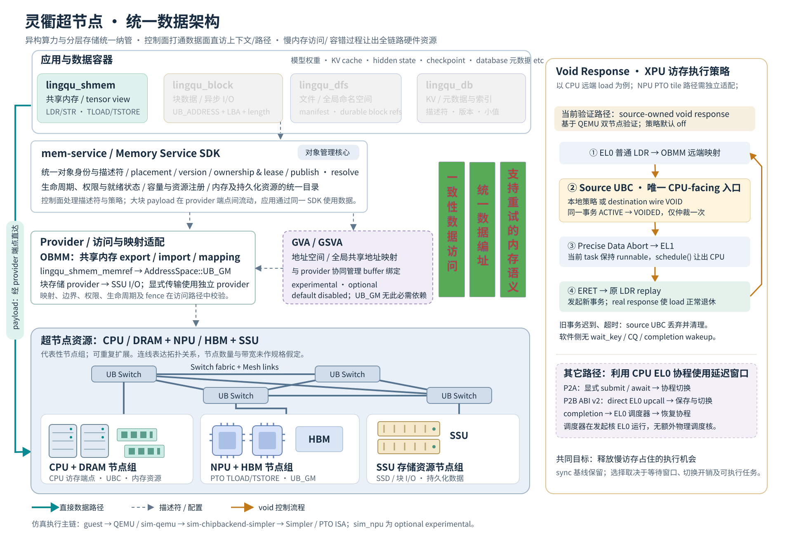
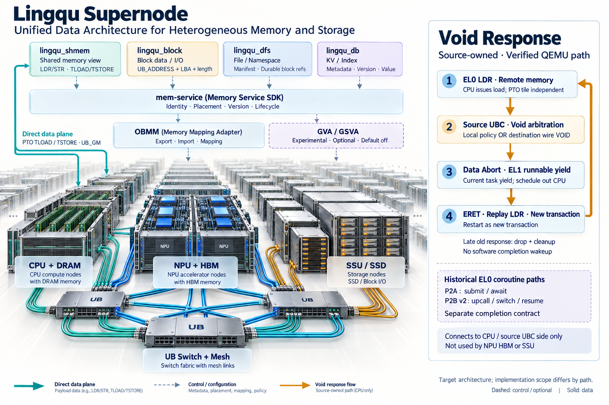

# Lingqu 超节点统一数据架构

日期：2026-09-10。

归档复核：2026-09-20。本文与图件保留 2026-09-10 的架构展示口径；图中的
optional/default-off 标签不定义每个部署配置的默认值。地址管理的实现状态及
验收差异以 [2026-09-19 复核计划](plans/2026-09-09-mem-service-gva-manager-integration-plan.md)
为准，不能从本图推断 managed GSVA 尚未实现或整体验收已经完成。

## 1. 图与使用方式

- [可编辑 SVG](2026-09-10-lingqu-supernode-data-architecture.svg)：精确架构关系与中文说明，以此版本为准。
- [图像化 PNG](2026-09-10-lingqu-supernode-data-architecture.generated.png)：立体设备、互联与软件层，用于展示和汇报。





SVG 保留原生文字、矩形、连线和可复用设备符号，按数据容器、资源管理、映射适配、
物理超节点、void response 分组。可在 Inkscape 等矢量编辑器中修改文字、颜色和位置。
本文及两个同名图件组成一组交付；渲染预览留在 `out/`，后续修改沿用这一命名约定。

## 2. 架构如何阅读

| 层次 | 图中组件 | 职责与边界 |
| --- | --- | --- |
| 应用与容器 | `lingqu_shmem`、`lingqu_block`、`lingqu_dfs`、`lingqu_db` | 提供内存、块、文件、KV 四种语义；模型权重、KV cache、hidden state 和 checkpoint 是数据内容示例 |
| 统一管理 | `mem-service` / Memory Service SDK | 统一对象身份、位置、版本、权限、ownership、lease 与生命周期；核心保持传输中立 |
| 共享内存访问 | OBMM provider | export/import/mapping 与共享内存访问适配；`lingqu_shmem_memref` 通过 `AddressSpace::UB_GM` 交给 PTO |
| 可选地址能力 | GVA / GSVA | 地址空间与共享地址映射，由地址管理和 provider 协同实现；保留 experimental、optional、default disabled 定位 |
| 块存储访问 | 块存储 provider、SSU | 通过设备地址、LBA 和长度执行块 I/O；SSD 块内容需经相应 I/O 路径进入内存缓冲区 |
| 超节点硬件 | CPU/DRAM、NPU/HBM、SSU、UB Switch、Mesh links | 展示异构计算、内存和持久化资源的目标组织方式；设备数量和连线数量仅作结构示意 |
| 慢访存策略 | source UBC、CPU exception/replay 路径 | 在满足策略条件时让出 CPU 执行机会，随后重试远端 load；具体完成契约见下节 |

控制面中的描述符与配置使用虚线，payload 直达路径使用青色实线。应用取得对象描述符
后通过 provider 访问 backing，Memory Service 控制面不充当大块 payload 的代理。
图中的统一纳管保留各容器的访问语义；它不意味着所有资源都支持同一种 CPU load/store。

OBMM 与 SSU 块存储分别承担共享内存映射和持久化 I/O 职责。显式传输使用独立
provider，OBMM 映射不由 URMA 实现。GVA/GSVA 在本图中作为可选能力呈现，
`UB_GM` 的直接访问目标不强制依赖 GVA/GSVA。

## 3. Void response：当前与历史契约

本次核对发现，最新 source-owned void-response 方案与早期 EL0 协程方案具有不同的
异常入口、调度单位和数据完成语义。图中将两者分别标注，避免跨版本拼接。

| 项目 | 2026-09-05 source-owned 验证路径 | 历史 P2B ABI v2 EL0 协程路径 |
| --- | --- | --- |
| 触发入口 | 发起并持有事务的 source UBC；本地策略和 destination wire VOID 汇入同一仲裁点 | 定制 direct EL0 upcall |
| 调度执行位置 | precise Data Abort 进入 EL1，当前 Linux task 保持 runnable 并 `schedule()` | 发起核上的 guest EL0 协程调度器保存上下文和切换 |
| 调度对象 | Linux task | 应用 coroutine |
| 继续执行 | `ERET` 回原 `LDR`，发起新事务 | completion 到达后调度器恢复挂起协程 |
| 旧事务迟到响应 | source UBC 丢弃并清理，不作为软件唤醒依据 | 属于关联 completion / coroutine 恢复契约 |
| 软件等待标识与完成队列 | 本路径不暴露 wait_key，不使用 CQ/IRQ completion wakeup | 历史事件与上下文关联机制，细节由对应 ABI 文档定义 |

当前 source-owned 路径中，同一事务最多发生一次 `ACTIVE → VOIDED`，后到的触发源
只记录仲裁失败。普通同步完成仍然保留，void policy 默认关闭。

当前策略使用配置给出的 latency/jitter 与故障窗口。实时队列深度、已等待时长和
destination health 等策略输入仍需后续扩展。图中不声明已经实现实时拥塞预测。

P2A 的显式 `submit/await` 和 P2B ABI v2 的 direct EL0 upcall 作为独立历史路径保留。
协程调度器使用发起核的 EL0 执行上下文，不需要增加一颗专用物理 CPU 调度核。
不能把其 completion-resume 过程接到当前 source-owned 的 late-response-drop 路径上。

## 4. 实现范围审计

- **物理资源图是目标架构。** CPU/DRAM、NPU/HBM、SSU 的设备图标不代表当前已完成
  大规模真实超节点、真实硬件性能或全硬件认证。
- **统一资源管理展示目标职责。** 它不表示当前所有容器、回收、恢复、权限和跨节点
  生命周期组合已经完成生产级验收；服务补齐计划仍列出后续阶段。
- **PTO 主执行链保持明确。** 当前验证通过 guest/QEMU、`sim-qemu`、
  `sim-chipbackend-simpler`、Simpler/PTO ISA CPU simulator 运行 callable。
  `sim_npu` 保持 optional experimental，不作为默认 PTO 主执行链。
- **CPU void response 与 PTO tile 访问分别评估。** 当前 source-owned 验证对象为 CPU
  `LDR`。将同类策略适配到 PTO `TLOAD/TSTORE` 的阻塞、tile 完成、错误恢复及调度接口，
  需要单独定义和验证；图中没有声称已经覆盖。
- **不搬用旧性能阈值。** 历史 P2A/P2B benchmark 使用对应的 ABI、workload 和环境，
  当前 source-owned replay 契约需要独立性能证据。图中不设置通用微秒级启用阈值。
- **SSU 按存储资源节点表示。** 上位设计明确举例 UB-attached SSD/SSU；本图未自行扩写
  SSU 英文全称，也未引入新的物理规格。

## 5. 依据

1. [Lingqu 数据系统定义（历史链接）](https://github.com/xwhu/pypto_workspace/blob/f43b084e281d/docs/pypto_top_level_design_documents/linqu_data_system.md)：本次实际核对工作区对应文件中的四类容器与 SSU 定义，未重新核验此历史远端链接。
2. [Lingqu 数据系统回顾](lingqu_datasystem_review.md)：容器、Memory Service 与 UB 模拟器之间的关系；历史状态按原文日期理解。
3. [PTO UB_GM direct-access 设计](plans/2026-08-29-lingqu-shmem-pto-ub-gm-direct-access-design.md)：执行主链、no-staging 口径与 optional feature 分类。
4. [Remote async load 整体方案](2026-09-03-async-load-overall-solution-introduction.md)：2026-09-05 修订后的 source ownership、exception 与 replay 契约。
5. [Source-owned void response 验证报告](2026-09-05-source-owned-void-response-validation-report.md)：两节点验证、exactly-once 仲裁和迟到响应清理。
6. [历史 EL0 协程设计](plans/async-load-coroutine-scheduler-detailed-design.md)：ABI v2 guest-owned context、direct EL0 upcall 与 coroutine 调度。
7. [GVA/GSVA 服务能力补齐计划](plans/2026-09-08-gva-gsva-service-completion-plan.md)：对象管理、地址管理和 provider 的边界及后续工作。
8. [UB-attached SSD 设计](sim_ub_attached_ssd_design.md)：块命令、缓冲区访问和持久化数据的边界。

## 6. 图像生成记录

方式：内置 `image_gen`，以 SVG 渲染作为架构参考，重新生成立体设备插画。
原生图像尺寸为 1536 × 1024，未做插值放大。已检查四种容器、三种资源节点、
Switch/Mesh 连接、OBMM 与可选 GVA/GSVA、source-owned void 流程和历史协程分支。
生成图使用英文标签，精确的中文解释及实现边界以 SVG 和本文为准。

内置工具没有显式模型选择参数。生成 PNG 内嵌的 C2PA softwareAgent 字段记录
`name=gpt-image`、`version=2.0`；此处按文件中的来源标识登记。

图像中的设备、线缆、服务器数量与内存模块排列均为视觉表达，不构成硬件规格。
GVA/GSVA 的虚线连接表达配置关系。侧栏 CPU-only 注释限定本次已验证的 void-response
路径，不对未来 NPU 或其他访问主体的扩展作结论。

本次仅新增文档与图件，执行了 SVG XML、唯一 ID、可编辑文字、无嵌入位图、关键标签、
LF 与行尾空格静态检查，并通过 Inkscape 实际渲染检查文字和连线。未运行工作负载或
全量测试；本文引用的功能验证来自对应验证报告。

### 实际生成提示

参考图为 SVG 的 PNG 渲染，角色为架构关系参考。

```text
Use case: scientific-educational.
Create a premium landscape technical architecture illustration for "Lingqu Supernode". Use the attached reference ONLY for correct architectural relationships, not its flat diagram aesthetic. Produce a highly legible isometric engineering illustration on a bright ivory background, dark navy typography, physically tangible silver server equipment, restrained teal memory accents, blue accelerator accents and amber storage/event accents. Wide 3:2 landscape, highest useful native detail. The main physical supernode must occupy the majority of the picture: repeated CPU servers with exposed DRAM DIMMs, repeated NPU accelerator boards with nearby HBM stacks, and SSU storage shelves with SSD drawers. Connect ALL three groups visibly into a shared network of UB switches with mesh inter-switch connections, real endpoints, no floating or disconnected cable ends. Clearly label "CPU + DRAM", "NPU + HBM", "SSU / SSD", and "UB Switch + Mesh". Use repeated nodes fading into distance to communicate large scale, no fabricated node counts.

Above the equipment, show restrained translucent LOGICAL software tiers, not extra hardware appliances: four small container tags "lingqu_shmem", "lingqu_block", "lingqu_dfs", "lingqu_db"; one unified layer "mem-service" with "Identity · Placement · Version · Lifecycle"; one memory-mapping adapter "OBMM" with "Export · Import · Mapping", linked logically to shared memory resources; beside it a dashed optional logical panel "GVA / GSVA" and "Experimental · Optional · Default off". These are software semantics, no GVA/GSVA chips. OBMM is a memory-mapping adapter, do not place SSU block storage behind OBMM as a mandatory dependency. Thin dashed metadata/configuration arrows connect software tiers to providers; solid teal direct-data routes bypass the mem-service control tier. Add small labels "Direct data plane" and "PTO TLOAD / TSTORE · UB_GM". SSU uses block I/O, not raw SSD load/store.

Right side, separated clean white inset occupying about 28% width, title "Void Response", subtitle "Source-owned · Verified QEMU path". Show a clean vertical numbered diagram with exactly these four boxes:
"1  EL0 LDR · Remote memory"
"2  Source UBC · Void arbitration"
"3  Data Abort · EL1 runnable yield"
"4  ERET · Replay LDR · New transaction"
Connect 1→2→3→4 with amber arrows; a return arrow from 4 to 1 represents replay. Small note adjacent to 2: "Local policy OR destination wire VOID". Under 4: "Late old response: drop + cleanup". Further note: "No software completion wakeup". Connect this inset conceptually with the CPU/source UBC side, never with NPU HBM or SSU.
At the bottom of the inset a separate dashed historical panel labelled "Historical EL0 coroutine paths" with two compact lines "P2A: submit / await" and "P2B v2: upcall / switch / resume". Add "Separate completion contract". No extra physical scheduler CPU core.

Footer: "Target architecture; implementation scope differs by path." Tiny legend "Dashed: control / optional" and "Solid: data". Maintain strong text contrast, crisp equipment, ample whitespace, elegant perspective, visually explanatory and polished for an architecture presentation. Text all English exactly as given. Do not reproduce dense Chinese paragraphs. No logos, watermarks, performance numbers, claims of production completeness, universal memory coherence, or implication that CPU void behavior already applies to PTO tile instructions. Current source-owned path does NOT resume from an old completion; it replays a new transaction. Historical EL0 coroutine path stays separate. Model request: image2 if the tool supports it; do not invent model metadata.
```
