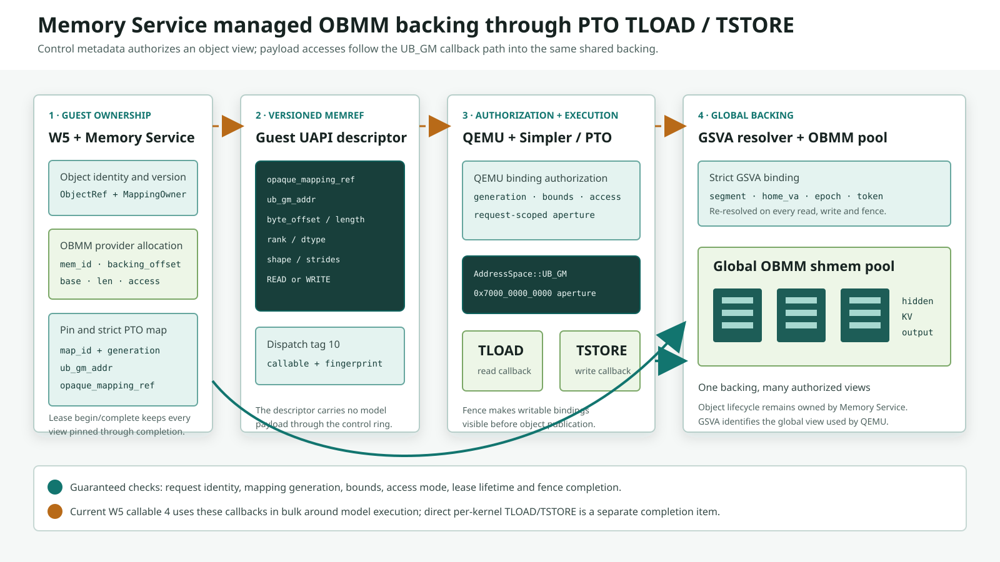
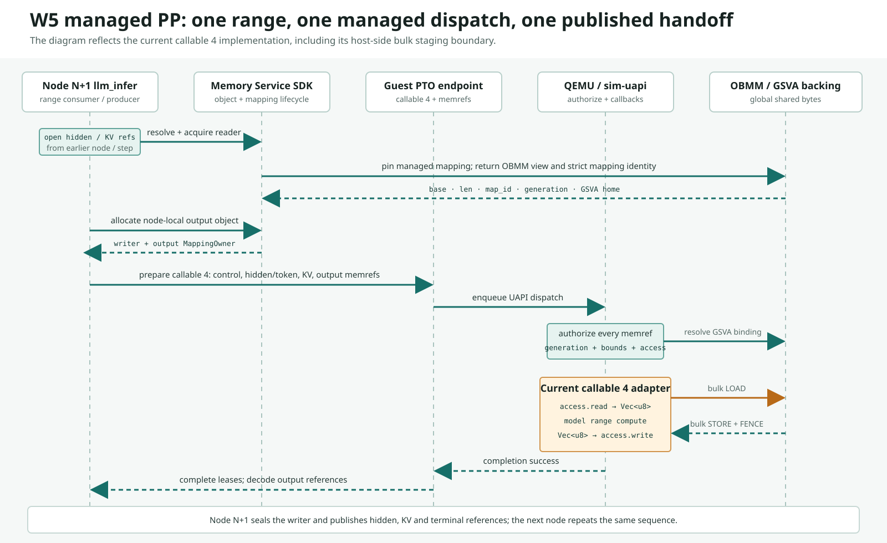
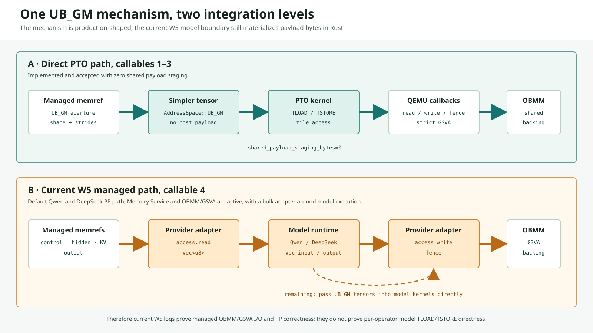

# W5、PTO TLOAD/TSTORE 与 OBMM-backed Memory Service 实现及验证报告

- 日期：2026-09-22
- 报告范围：当前 `ub_sim` 工作区、Memory Service、PTO ISA、Simpler 和 QEMU
  联合实现
- 验证范围：`n4-910c`、`n4-910c1` 上的 Qwen3 和 DeepSeek V4 Flash W5
  2/4/8-node PP 功能矩阵

## 1. 结论

当前实现需要按三个层次评估。

| 层次 | 当前状态 | 结论 |
| --- | --- | --- |
| PTO `TLOAD/TSTORE` 访问 OBMM-backed managed object | 已实现 | Memory Service 对象可以被 pin 成严格 PTO mapping；PTO CPU backend 可以把 `AddressSpace::UB_GM` tensor 的 `TLOAD/TSTORE` 转为受控的 QEMU read/write/fence callback；QEMU 通过 GSVA identity 访问 OBMM backing |
| W5 PP 使用 Memory Service + OBMM/GSVA 完成 hidden、KV 和 output 交接 | 已实现，并已成为当前工作区默认 W5 路径 | Qwen3 与 DeepSeek V4 Flash 在两个 test-farm 上的 2/4/8-node、2-step 矩阵共 12 次运行全部通过 |
| W5 模型 kernel 内部直接以 managed `UB_GM` tensor 执行 `TLOAD/TSTORE` | 尚未完成 | 当前默认 callable 4 在模型调用前通过 QEMU callback 批量读入 Rust `Vec<u8>`，计算结束后再批量写回。它复用了相同的 memref、authorization、GSVA 和 OBMM 数据面，但模型算子尚未直接持有 managed `UB_GM` tensor |

因此，以下两项结论可以由当前代码和运行日志直接支持：

1. PTO direct-access 基础机制已经具备从 managed object 到 OBMM/GSVA backing 的
   完整能力。
2. 当前 W5 PP 已经通过 Memory Service 管理对象，并通过 OBMM/GSVA callback 数据面
   完成跨节点 hidden、KV、output 和 terminal token 流转。

以下结论目前缺少证据，也与当前 callable 4 的代码不相符：

> Qwen3 或 DeepSeek V4 Flash 的每一个模型算子，已经直接对 Memory Service managed
> object 执行 PTO `TLOAD/TSTORE`，且模型边界没有 payload materialization。

这条边界是本报告最重要的审计结论。图 1 展示已经实现的完整基础机制。



## 2. 代码与证据版本

### 2.1 源码身份

报告编写时的源码身份如下。

| 仓库 | Revision | 说明 |
| --- | --- | --- |
| `ub_sim` 本地基线 | `2e0ca160373ae20787f01cf688ae0c31a22394d5` | 当前 `master` HEAD |
| test-farm 源码快照 | `5d53f492e6957f563cd90000359ff7b7d6dee066` | sim-console 为当前工作区变更生成的验证快照 |
| `mem_service` | `f16920a8645e30776016e333749abb3584ec6585` | managed GVA/GSVA 与 OBMM provider 实现 |
| `vendor/pto-isa` | `6a9da1e1e9571f98de1c43d88d58478804948410` | CPU `TLOAD/TSTORE` UB_GM callback 实现 |
| `vendor/qemu_8.2.0_ub` | `04e536fb9d8cb648cb998ad196e2f06830ccba8b` | mapping authorization、GSVA bind 和 OBMM I/O |
| `vendor/simpler` | `3794c4309fbdb8d20a262ced4e7cb1b3fa823261` | UB_GM tensor 与 PTO run-context 绑定 |

test-farm 快照包含当前尚未提交的 W5 managed-default 配置变更。报告中的“当前默认”
指该工作区和对应验证快照，不能外推到仅 checkout `2e0ca160` 且丢弃工作区变更的目录。

### 2.2 运行证据位置

每次 sim-console 运行在目标机上保留两类证据：

- 汇总：
  `guest-linux/aarch64/out/eight_node_w5_inference_cluster_summary.<run-id>.txt`
- 节点日志：
  `guest-linux/aarch64/logs/<run-id>_headless8/node{A..H}_{guest,qemu}.log`

日志目录名保留了历史 `headless8` 命名；2-node 和 4-node 运行也由同一套 harness
生成目录。实际拓扑由运行配置和 `passed_nodes=N/N` 判定。

## 3. 术语和职责边界

| 名称 | 职责 |
| --- | --- |
| Memory Service object | 维护 object identity、version、placement、lease 和生命周期 |
| OBMM provider | 为 object 提供 shmem backing、export/import、pin 和本地/远端 mapping |
| `MappingOwner` | 持有一个受 Memory Service 生命周期保护的 object mapping |
| `lingqu_shmem_memref` | 描述 object 中一个带 offset、length、shape、stride 和 access 的 tensor view |
| `opaque_mapping_ref` | 编码 OBMM map ID 和 generation，防止旧 mapping 被继续使用 |
| `AddressSpace::UB_GM` | Simpler/PTO 用来标识受 callback 管理的全局内存地址空间 |
| GSVA | QEMU 数据面使用的 global shared virtual address identity；包含 segment、home、epoch 和 backing token |
| PTO `TLOAD/TSTORE` | tile 与 global tensor 之间的数据访问指令语义 |
| callable 1–3 | 当前 direct PTO UB_GM callables；把 managed memref 直接 materialize 为 UB_GM tensor |
| callable 4 | 当前 W5 managed model adapter；在模型 range 调用边界执行批量 read/compute/write |

Memory Service 负责对象和地址生命周期。OBMM 提供共享内存 backing。GSVA 让 QEMU
能够按全局 identity 重新定位 backing。PTO 只看到 `UB_GM` tensor 和
read/write/fence interface，PTO kernel 无需了解 OBMM API。

## 4. TLOAD/TSTORE 如何支持 OBMM-backed Memory Service

### 4.1 Memory Service object 取得严格 PTO mapping

入口位于
[`lingqu_shmem_mem_service_obmm.c`](../guest-linux/aarch64/libs/lingqu_shmem_pto/lingqu_shmem_mem_service_obmm.c)
的 `obmm_compute_acquire_managed()`。

```c
rc = mem_service_provider_obmm_mapping_pin_acquire(
    &mapping->binding, access_flags, &lease->pin, &view);
if (rc) {
    if (lease->pin) binding_out->backend_lease = lease;
    else free(lease);
    return rc;
}

rc = obmm_async_map_register_strict_pto(
    context->async_runtime,
    view.obmm_fd,
    view.mem_id,
    view.base,
    view.len,
    &lease->map);

rc = lingqu_shmem_pto_obmm_mapping_ref(
    lease->map.id,
    lease->map.generation,
    &mapping_ref);

binding_out->region = (struct lingqu_shmem_sim_region_desc) {
    .mapped_addr = view.base,
    .mapped_length = view.len,
    .ub_gm_addr = lease->map.local_pa,
    .opaque_mapping_ref = mapping_ref,
};
```

这段代码完成四件事：

1. 从 Memory Service 的 provider binding 取得并 pin 住 OBMM mapping。
2. 把该 mapping 注册到严格 PTO 路径。
3. 把 `map.id` 和 `map.generation` 编码成 opaque reference。
4. 形成 `mapped_addr`、`mapped_length`、`ub_gm_addr` 和 mapping identity
   的绑定。

`generation` 是 stale protection 的关键。相同 map slot 被回收并重新使用后，旧
`opaque_mapping_ref` 的 generation 不再匹配，QEMU 必须 fail-closed。

### 4.2 managed view 被序列化成版本化 PTO memref

[`lingqu_shmem.c`](../guest-linux/aarch64/libs/lingqu_shmem_pto/lingqu_shmem.c)
在 dispatch prepare 阶段增加 memref 和 region 的 in-flight 引用，然后构造 wire
descriptor：

```c
atomic_fetch_add_explicit(
    &memref->inflight_count, 1, memory_order_acq_rel);
atomic_fetch_add_explicit(
    &region->inflight_count, 1, memory_order_acq_rel);

wire_memrefs[index] = (struct lingqu_shmem_pto_memref_desc) {
    .opaque_mapping_ref = region->opaque_mapping_ref,
    .ub_gm_addr = region->ub_gm_addr,
    .byte_offset = memref->spec.byte_offset,
    .byte_length = memref->spec.byte_length,
    .arg_index = request->memrefs[index].arg_index,
    .rank = memref->spec.rank,
    .dtype = memref->spec.dtype,
    .role = role_from_access(memref->spec.access),
    .access = memref->spec.access,
};
memcpy(wire_memrefs[index].shape, memref->spec.shape, ...);
memcpy(wire_memrefs[index].strides, memref->spec.strides, ...);
```

该 descriptor 只携带控制信息。对象 payload 不进入 UAPI control ring。shape 和
stride 也属于授权输入，因为 strided tensor 的最大可达 offset 可能大于连续逻辑
长度。

### 4.3 QEMU 将 memref 授权成 request-scoped UB_GM aperture

QEMU 的
[`ub_ubc.c`](../vendor/qemu_8.2.0_ub/hw/ub/ub_ubc.c)
在接受 dispatch 前完成以下校验：

- `opaque_mapping_ref` 能否解析；
- map ID 和 generation 是否仍然相同；
- local PA、remote UBA 和授权快照是否一致；
- requested range 是否位于 mapping 内；
- `READ`/`WRITE` 是否被 provider 允许；
- write view 是否落在 read-only mapping；
- aperture 分配是否溢出或重叠。

核心身份重校验如下：

```c
if (authorization &&
    (!ub_obmm_async_resolve_mapping_ref(
         ubc_dev->obmm_async,
         memref->opaque_mapping_ref,
         view_start,
         memref->byte_length,
         &current) ||
     !ubc_obmm_map_identity_equal(&current, &resolved) ||
     current.local_pa != resolved.local_pa ||
     current.remote_uba != resolved.remote_uba)) {
    error = LINGQU_PTO_UB_GM_UNBOUND;
    goto out;
}
```

授权通过后，QEMU 为每个 memref 构造 binding：

```c
item->binding = (PtoSimUbGmBindingV1) {
    .request_id = control.request_id,
    .binding_id = (uint64_t)memref->arg_index + 1,
    .aperture_base = aperture,
    .aperture_length = memref->byte_length,
    .ub_gm_base = view_start,
    .mapped_length = memref->byte_length,
    .access = memref->access,
    .backend_cookie = memref->opaque_mapping_ref,
};
```

`aperture_base` 是 PTO CPU backend 能识别的 synthetic pointer；`ub_gm_base` 对应
经过授权的 object view。二者只在当前 request 的 run context 内有效。

### 4.4 Simpler 将 aperture materialize 为 UB_GM tensor

[`sim-chipbackend-simpler/src/lib.rs`](../crates/sim-chipbackend-simpler/src/lib.rs)
提供显式 UB_GM tensor 构造器：

```rust
pub fn from_ub_gm(
    aperture_addr: u64,
    bytes: u64,
    shape: &[u32],
    strides: &[u32],
    dtype: DataType,
) -> Result<Self, SimplerApiError> {
    Self::from_shape_and_strides(
        aperture_addr,
        bytes,
        shape,
        strides,
        dtype,
        AddressSpace::UbGm,
    )
}
```

在 callable launch 前，Rust adaptor 把 request-scoped run context 绑定到 Simpler：

```rust
if let Some(run_context) = ub_gm_run_context {
    bind(
        ctx.as_raw(),
        runtime.as_raw(),
        run_context.as_ptr(),
    )?;
}
let launch_code = self.launch_run(...);
```

Simpler 的
[`c_api_shared.cpp`](../vendor/simpler/src/common/platform/sim/host/c_api_shared.cpp)
只允许在 `Prepared` phase 绑定一次：

```cpp
if (state == nullptr || run_context == nullptr ||
    state->phase.load(std::memory_order_acquire) !=
        NativeRunPhase::Prepared ||
    state->prepared_execution == nullptr ||
    state->prepared_execution->pto_ub_gm_run_context != nullptr) {
    return -1;
}
state->prepared_execution->pto_ub_gm_run_context = run_context;
```

因此 worker thread 在执行 PTO kernel 时能找到当前 request 的 bindings 和 callback
ops，其他 request 无法复用该 context。

### 4.5 PTO TLOAD 的行为

[`TLoad.hpp`](../vendor/pto-isa/include/pto/cpu/TLoad.hpp)
先判断 global tensor pointer 是否落在保留 aperture，随后按 shape/stride 计算实际
element ranges：

```cpp
auto *source = src.data();
if (cpu::ub_gm::isReservedAddress(
        reinterpret_cast<uintptr_t>(source))) {
    const cpu::ub_gm::TensorAccessPlan plan =
        cpu::ub_gm::tensorAccessPlan(
            shapes, strides, 5, tileElements);

    (void)cpu::ub_gm::resolve(
        reinterpret_cast<uintptr_t>(source),
        storageBytes,
        cpu::ub_gm::Access::Read);

    for (const cpu::ub_gm::ElementRange &range : plan.ranges) {
        if (!cpu::ub_gm::read(
                source + range.offset,
                scratch.data() + range.offset,
                rangeBytes)) {
            throw cpu::ub_gm::Error(
                cpu::ub_gm::ErrorCode::ExecutionFailed);
        }
    }
    TLoad(dst.data(), scratch.data(), ...);
    return;
}
```

这里的 scratch 是 PTO CPU simulator 的 tile materialization 实现细节。payload 不经
guest runtime、`sim-uapi::segment_payloads` 或模型 adapter 复制；读取来源仍是经过
QEMU 授权的 OBMM object view。

### 4.6 PTO TSTORE 的行为

[`TStore.hpp`](../vendor/pto-isa/include/pto/cpu/TStore.hpp)
对 writable aperture 执行相反方向的数据流：

```cpp
auto *destination = dst.data();
if (cpu::ub_gm::isReservedAddress(
        reinterpret_cast<uintptr_t>(destination))) {
    const cpu::ub_gm::TensorAccessPlan plan =
        cpu::ub_gm::tensorAccessPlan(
            shapes, strides, 5, tileElements);

    (void)cpu::ub_gm::resolve(
        reinterpret_cast<uintptr_t>(destination),
        storageBytes,
        cpu::ub_gm::Access::Write);

    TStore(scratch.data(), src.data(), ...);
    for (const cpu::ub_gm::ElementRange &range : plan.ranges) {
        if (!cpu::ub_gm::write(
                destination + range.offset,
                scratch.data() + range.offset,
                rangeBytes)) {
            throw cpu::ub_gm::Error(
                cpu::ub_gm::ErrorCode::ExecutionFailed);
        }
    }
    return;
}
```

direct callable 完成后会对所有 writable binding 执行 fence。缺少 fence callback、
binding 不可写、range 越界、run context 缺失或 callback 失败都会抛出明确错误。

### 4.7 QEMU callback 最终访问 GSVA/OBMM backing

PTO `read()`/`write()` 通过
[`ub_gm_access.hpp`](../vendor/pto-isa/include/pto/cpu/ub_gm_access.hpp)
取得 binding，并调用 QEMU 注册的 callbacks：

```cpp
resolution.run->ops->read(
    resolution.run->backend_context,
    resolution.run->request_id,
    resolution.binding->binding_id,
    resolution.ub_gm_addr,
    dst,
    length);
```

QEMU 每一次 callback 都重新检查 mapping 仍然有效。strict GSVA mapping 的 read
走 `ubc_sim_dec_remote_io(..., write=false, GsvaHomeIdentity)`；write 走同一接口并设置
`write=true`：

```c
if (resolved.strict_gsva) {
    ret = ubc_sim_dec_remote_io(
        ubc_dev,
        resolved.remote_uba,
        resolved.gsva.backing_token_id,
        resolved.peer_cna,
        dst,
        (uint32_t)length,
        true,
        false,
        &home_identity);
} else {
    ret = ubc_sim_dec_remote_read(...);
}
```

write callback 还会拒绝 read-only mapping。fence 要求 binding 已经发生写入，随后
记录 completion ordering。最终 backing 始终是 provider 管理的 OBMM shmem object。

### 4.8 这套机制的 fail-closed 条件

| 异常 | 结果 |
| --- | --- |
| mapping ref 无法解析 | `BAD_MEMREF` / `UNBOUND` |
| map generation 已更新 | `UNBOUND` |
| range 跨越 mapping 边界 | `BAD_MEMREF` |
| read-only mapping 请求 write | `ACCESS_DENIED` |
| tensor shape/stride extent 超出 view | `BAD_MEMREF` |
| request context 缺失或 binding 不唯一 | PTO `Unbound` / `BadMemref` |
| QEMU callback 执行失败 | PTO `CallbackFailed` |
| writable binding 没有 dirty state 就 fence | callback failure |
| lease 尚未完成时提前释放 mapping | in-flight ownership 阻止释放，或后续访问 fail-closed |

没有 host-copy fallback。任何 mapping、权限或生命周期错误都终止当前 dispatch。

## 5. 当前 W5 PP 如何与这套机制交互

### 5.1 当前默认入口选择 managed serving

当前工作区的
[`run_w5_cluster_config.sh`](../guest-linux/aarch64/scripts/run_w5_cluster_config.sh)
在没有显式 override 时选择 managed serving：

```bash
export SIM_W5_MANAGED_SERVING="${SIM_W5_MANAGED_SERVING:-1}"

if bool_enabled "$SIM_W5_MANAGED_SERVING"; then
  export SIM_W5_MANAGED_SERVING=1
  export SIM_LINGQU_SHMEM_PTO_ENABLE=1
  export SIM_W5_QWEN3_PTO=0
  export SIM_W5_PTO_UB_GM_PROBE=0
  export SIM_W5_PTO_UB_GM_PUBLISH_OUTPUT=0
fi
```

这几项配置说明当前默认运行使用 managed callable 4，并关闭早期 Qwen PTO probe。
Qwen3 和 DeepSeek V4 Flash 都进入同一个 managed serving object/data lifecycle。

### 5.2 启动阶段先建立基础设施

[`w5_managed_runtime_obmm.c`](../guest-linux/aarch64/libs/lingqu_shmem_pto/w5_managed_runtime_obmm.c)
在模型 range 开始前完成：

1. probe OBMM device；
2. 初始化 provider registry；
3. 打开 OBMM endpoint；
4. 准备和交换 peer canary；
5. 注册 provider；
6. 建立 peer-mapping channel；
7. 创建 Memory Service access domain；
8. 打开 managed compute context 和 PTO endpoint。

本报告采集运行时，启动日志为：

```text
w5_managed_serving_runtime_open ...
callable=4 control=mem_service data=obmm status=ok
```

该 marker 表示当前节点已经具备 Memory Service control plane、OBMM data provider 和
PTO dispatch endpoint。任一部分失败都会终止 W5 节点启动。

后续收尾已经把容易误解的字段改成显式执行模式。当前 callable 4 应打印：

```text
target=managed_model_provider provider_address_space=UB_GM
model_io_mode=bulk_provider_callbacks model_tensor_address_space=HOST
pto_instruction_io=0 status=ok
```

W6 完成 direct model tensor 后才允许把后两项切换为 `UB_GM` 和 `1`。

### 5.3 一个 PP range 的输入对象

[`llm_infer.c`](../guest-linux/aarch64/apps/llm_infer/llm_infer.c)
在每个 node、每个 decode step 组装输入：

```c
if (layer_start > 0U) {
    rc = w5_managed_open_reader(
        runtime, hidden_reference_key, ...,
        &state->hidden);
}
if (decode_step > 0U) {
    rc = w5_managed_open_reader(
        runtime, kv_reference_key, ...,
        &state->kv);
}

if (layer_start > 0U)
    operation_request.inputs[
        operation_request.input_count++] = state->hidden;
else if (decode_step > 0U)
    operation_request.inputs[
        operation_request.input_count++] = state->token;

if (decode_step > 0U)
    operation_request.inputs[
        operation_request.input_count++] = state->kv;
```

输入规则如下。

| 位置 | step 0 | step 1 及以后 |
| --- | --- | --- |
| node A | control；prompt 在 control metadata 中 | control + previous token + node A previous KV |
| node B..last | control + previous node hidden | control + previous node hidden + local previous KV |

每个 node 同时通过 `w5_managed_writer_open()` 在自己的 home 上分配本轮 output
object。output object 最终容纳 hidden、KV、terminal/logits metadata 和可发布引用。

### 5.4 callable 4 把 Memory Service owner 转为 memrefs

[`w5_managed_model_guest.c`](../guest-linux/aarch64/libs/lingqu_shmem_pto/w5_managed_model_guest.c)
把 control、0–2 个模型输入和 output owner 转成最多四个 memrefs：

```c
for (unsigned i = 0; i < op->count; ++i) {
    struct lingqu_shmem_memref_spec spec = {
        .byte_offset = offsets[i],
        .byte_length = lengths[i],
        .rank = 1,
        .dtype = 4,
        .shape = {(uint32_t)lengths[i]},
        .strides = {1},
        .access = i + 1 == op->count ?
            LINGQU_SHMEM_ACCESS_WRITE :
            LINGQU_SHMEM_ACCESS_READ,
    };
    rc = lingqu_shmem_mem_service_acquire_owned(
        context,
        owners[i],
        &spec,
        &args[i].memref,
        &op->leases[i]);
}

request.callable_id = W5_MANAGED_MODEL_CALLABLE_ID; /* 4 */
```

submit 前，每个 lease 都进入 in-flight：

```c
while (op->begun < op->count) {
    rc = lingqu_shmem_mem_service_lease_begin(
        op->leases[op->begun], op->op_id);
    if (rc) return rc;
    ++op->begun;
}
rc = lingqu_shmem_pto_endpoint_enqueue(endpoint, &op->slot);
```

收到 completion 后，所有 lease 才能完成。这样可以防止模型执行期间 object 被驱逐、
unmap 或复用。

### 5.5 当前 callable 4 的真实数据路径

[`sim-uapi/src/lib.rs`](../crates/sim-uapi/src/lib.rs)
按 callable ID 分流：

```rust
if req.callable_id == managed_model_dispatch::CALLABLE_ID {
    return managed_model_dispatch::run(topology, req, access);
}

match req.callable_id {
    PTO_UB_GM_HOST_VECTOR_CALLABLE_ID => { ... }
    PTO_UB_GM_QWEN3_OPERATOR_CALLABLE_ID => { ... }
    PTO_UB_GM_QWEN3_RANGE_CALLABLE_ID => { ... }
    _ => return Err(...),
}
```

callable 1–3 进入 `LocalRuntimeEngine`，注册 UB_GM access，并在运行后检查：

```rust
runtime.register_pto_ub_gm_access(access)?;
runtime.submit_dispatch(...)?;
...
if runtime.host_payload_bytes() != private_constant_bytes {
    return Err("pto_ub_gm_payload_staging_detected".to_string());
}
```

这是真正的 direct PTO path。

callable 4 当前走
[`managed_model_dispatch.rs`](../crates/sim-uapi/src/managed_model_dispatch.rs)。
它通过同一组 QEMU callbacks 批量读写，但在模型调用边界构造 `Vec<u8>`：

```rust
fn read(
    access: PtoUbGmAccessRegistration,
    view: &View<'_>,
) -> Result<Vec<u8>, String> {
    let mut bytes = vec![0; view.view.byte_length as usize];
    (access.read)(..., view.address, bytes.as_mut_ptr().cast(), ...);
    Ok(bytes)
}

for view in input_views {
    inputs.push(ManagedModelInput::from_provider_bytes(
        reference,
        read(access, view)?,
    )?);
}

let operands = resolve_managed_operands(..., inputs)?;
let bytes = compute(&task, &segment, &operands)?;
(access.write)(..., output.address, bytes.as_ptr().cast(), ...);
(access.fence)(..., output.address, bytes.len() as u64, 0);
```

图 2 是当前 PP 时序。黄色块表示 callable 4 的批量 materialization 边界。



### 5.6 Qwen 与 DeepSeek 的共同点和差异

共同点：

- control、hidden/token、KV 和 output 都由 Memory Service object 表示；
- object mapping 都由 OBMM provider 提供；
- callable 4 的 provider read/write 都经过 QEMU authorization 和 strict GSVA；
- PP handoff 发布的是 object reference；
- completion 后才 seal writer 并发布下一节点可见的引用。

模型差异：

- Qwen managed path调用当前 Qwen dense range runtime；
- DeepSeek managed path调用 DeepSeek V4 Flash range runtime，并执行对应的 43 层
  分片、MoE/linear 路径和 terminal logits 生成；
- 两条路径接收的 managed input 已经在 callable 4 边界变成 Rust-owned bytes；
- 两条路径的模型内部 tensor 目前都没有直接引用本轮 managed UB_GM aperture。

图 3 精确表达 direct callables 和当前 W5 callable 4 的差别。



### 5.7 range 完成后的对象发布

模型输出经 write + fence 写入 node-local OBMM-backed output object。serving layer 随后：

1. 解码 output 中的 hidden、KV、terminal 和 token records；
2. 等待 provider visibility；
3. 为 hidden、KV、terminal 和 token 生成 object references；
4. seal writer；
5. 把引用提交给后续 node 或下一 decode step。

最后一个 pipeline node 从 terminal record 取得 logits 和 sampled token，日志来源标记为
`managed_callable4_logits`。中间 node 发布 hidden，所有 node 发布本地 KV 供下一 step
使用。

## 6. Test-farm 运行矩阵

### 6.1 验证条件

本轮矩阵使用：

- 两台 openEuler test-farm：`n4-910c`、`n4-910c1`；
- Qwen3 managed dense profile；
- DeepSeek V4 Flash managed Simpler profile；
- 2、4、8 个 QEMU guest node；
- 每次 2 个 decode steps；
- `SIM_W5_MANAGED_SERVING=1`；
- `SIM_LINGQU_SHMEM_PTO_ENABLE=1`；
- callable 4；
- Memory Service control plane + OBMM data provider + strict GSVA bindings。

### 6.2 12 次运行结果

| Target | Model | Nodes | Run ID | Passed nodes | Range records | Handoff records | Guest pass records |
| --- | --- | ---: | --- | ---: | ---: | ---: | ---: |
| `n4-910c` | Qwen3 | 2 | `sim-console-1790000349488-0` | 2/2 | 4 | 4 | 4 |
| `n4-910c` | Qwen3 | 4 | `sim-console-1790000705488-0` | 4/4 | 8 | 8 | 8 |
| `n4-910c` | Qwen3 | 8 | `sim-console-1790001108638-0` | 8/8 | 16 | 16 | 16 |
| `n4-910c` | DeepSeek V4 Flash | 2 | `sim-console-1789998449170-0` | 2/2 | 4 | 4 | 4 |
| `n4-910c` | DeepSeek V4 Flash | 4 | `sim-console-1789998974041-0` | 4/4 | 8 | 8 | 8 |
| `n4-910c` | DeepSeek V4 Flash | 8 | `sim-console-1789999718934-0` | 8/8 | 16 | 16 | 16 |
| `n4-910c1` | Qwen3 | 2 | `sim-console-1789998992967-0` | 2/2 | 4 | 4 | 4 |
| `n4-910c1` | Qwen3 | 4 | `sim-console-1789999058256-0` | 4/4 | 8 | 8 | 8 |
| `n4-910c1` | Qwen3 | 8 | `sim-console-1789999134805-0` | 8/8 | 16 | 16 | 16 |
| `n4-910c1` | DeepSeek V4 Flash | 2 | `sim-console-1789999442935-0` | 2/2 | 4 | 4 | 4 |
| `n4-910c1` | DeepSeek V4 Flash | 4 | `sim-console-1790000128867-0` | 4/4 | 8 | 8 | 8 |
| `n4-910c1` | DeepSeek V4 Flash | 8 | `sim-console-1790000818537-0` | 8/8 | 16 | 16 | 16 |

所有运行都满足：

```text
decode_steps_expected=2
decode_steps_observed=2
worker_timing_records=2 * node_count
handoff_timing_records=2 * node_count
passed_nodes=node_count/node_count
```

## 7. 运行日志证据

### 7.1 8-node 事件计数

在 `n4-910c` 的 Qwen 8-node 和 DeepSeek 8-node 日志中，两次运行都得到完全相同的
managed data-plane 事件数量：

| Marker | Qwen | DeepSeek | 含义 |
| --- | ---: | ---: | --- |
| `w5_managed_serving_runtime_open` | 8 | 8 | 每个 node 的 managed runtime 启动成功 |
| `w5_managed_model_range_complete` | 16 | 16 | 8 nodes × 2 steps 全部 range 完成 |
| `QEMU_UB_GM_INPUT_AUTHORIZE` | 39 | 39 | 所有 control、hidden/token、KV input view 获权 |
| `QEMU_UB_GM_OUTPUT_AUTHORIZE` | 16 | 16 | 每个 range 的 output view 获权 |
| `QEMU_UB_GM_GSVA_BIND` | 55 | 55 | 39 inputs + 16 outputs 全部取得 strict GSVA binding |
| `QEMU_UB_GM_LOAD` | 39 | 39 | callable 4 对每个 input view 执行一次批量 read |
| `QEMU_UB_GM_STORE` | 16 | 16 | 每个 range 将结果写回 output object |
| `QEMU_UB_GM_FENCE` | 16 | 16 | 每个 output 在发布前完成 fence |
| `managed-model-provider: ... completion=success` | 16 | 16 | 每个 callable 4 dispatch 成功 |
| `w5_managed_request_cleanup` | 8 | 8 | 每个 node 完成 request 资源回收 |

39 个 input view 可以由拓扑和 step 规则精确推导：

| 范围 | 每个 node 的授权输入 | 数量 |
| --- | --- | ---: |
| step 0, node A | control | 1 |
| step 0, node B–H | control + hidden | 7 × 2 = 14 |
| step 1, node A | control + token + KV | 3 |
| step 1, node B–H | control + hidden + KV | 7 × 3 = 21 |
| 合计 |  | **39** |

每个 node、每个 step 恰好一个 output，因此 output/store/fence 均为 `8 × 2 = 16`。
`39 + 16 = 55` 与 GSVA bind 数量完全一致。这个一致性排除了部分 input 绕过
managed mapping 的情况。

### 7.2 Qwen 8-node 汇总

运行 `sim-console-1790001108638-0` 的汇总包含：

```text
decode_steps_expected=2
decode_steps_observed=2
worker_timing_records=16
passed_nodes=8/8
handoff_timing_records=16
decode_output: token_ids=[264, 3644]
decode_output: token_pieces=" a global"
```

这说明 16 个 node-step range 全部完成，两个 terminal token 被送到 stream output。

node A 的 managed runtime 和 range 日志包含：

```text
[w4_guest] stage w5_managed_serving_transport_config ...
source=lingqu_memory_service target=simpler_pto
address_space=UB_GM status=ok

[w4_guest] stage w5_managed_serving_runtime_open ...
nodes=8 ... callable=4 control=mem_service data=obmm status=ok

[w4_guest] stage w5_managed_model_range_complete
node=1 step=0 layers=[0,4) ... inputs=0 outputs=3
hidden_bytes=262144 kv_bytes=98464
allocation_home=guest-node-0 terminal=0 status=ok

[w4_guest] stage w5_managed_model_range_complete
node=1 step=1 layers=[0,4) ... inputs=2 outputs=3
hidden_bytes=2048 kv_bytes=131232
allocation_home=guest-node-0 terminal=0 status=ok
```

这里的 `inputs` 只统计模型数据输入，不包含 control memref。因此 step 0 node A
显示 `inputs=0`，QEMU 仍然会授权并读取一个 control view。

node H 的日志包含：

```text
[w4_guest] stage w5_managed_model_range_complete
node=8 step=0 layers=[25,28) ... inputs=1 outputs=5
hidden_bytes=262144 kv_bytes=98464
allocation_home=guest-node-7 terminal=1 status=ok

[w4_guest] stage w5_managed_model_range_complete
node=8 step=1 layers=[25,28) ... inputs=2 outputs=5
hidden_bytes=2048 kv_bytes=131232
allocation_home=guest-node-7 terminal=1 status=ok
```

`terminal=1` 只出现在最后一个 pipeline node。它证明 terminal record 与普通 hidden/KV
output 一起由 managed output object 返回。

### 7.3 QEMU 对 Qwen object view 的证据

同一运行的 node B QEMU 日志中，稳定字段如下。为提高可读性，run-local request ID
和地址被省略，binding、长度、mapping generation 和 GSVA identity 保留：

```text
QEMU_UB_GM_INPUT_AUTHORIZE ...
binding=1 length=8768 map=4 generation=1 peer_cna=0xc4d2
QEMU_UB_GM_GSVA_BIND ...
segment=0xc4d2000000000001 home_va=0x700044000000
epoch=1 lease_epoch=1 backing_token=97

QEMU_UB_GM_INPUT_AUTHORIZE ...
binding=2 length=262144 map=3 generation=1 peer_cna=0xc4c2
QEMU_UB_GM_OUTPUT_AUTHORIZE ...
binding=3 length=33554432 ...

QEMU_UB_GM_LOAD ... binding=1 length=8768 map=4 generation=1
QEMU_UB_GM_LOAD ... binding=2 length=262144 map=3 generation=1
QEMU_UB_GM_STORE ... binding=3 length=405008 map=4 generation=1
QEMU_UB_GM_FENCE ... binding=3 length=405008
managed-model-provider: ... inputs=1 output_bytes=405008
completion=success
```

该片段逐项证明：

1. control 和 remote hidden 都被授权；
2. 两个 input 和一个 output 都取得 strict GSVA binding；
3. callable 4 从原 managed views 读取 8,768 B control 和 262,144 B hidden；
4. 405,008 B output 被写回已授权的 32 MiB output capacity；
5. write 后执行 fence；
6. provider dispatch 返回 success。

step 1 的同一 node 出现三次 read：8,768 B control、2,048 B hidden 和 98,464 B
previous KV；之后写回 177,680 B 新 output 并 fence。这验证了连续 decode 时本节点 KV
通过 Memory Service object 被重新消费。

### 7.4 DeepSeek V4 Flash 8-node 汇总

运行 `sim-console-1789999718934-0` 的汇总包含：

```text
decode_steps_expected=2
decode_steps_observed=2
worker_timing_records=16
passed_nodes=8/8
handoff_timing_records=16
decode_output: token_ids=[65, 20]
decode_output: token_pieces="_2"
```

node H 终端日志包含：

```text
[w4_guest] stage deepseek_v4_flash_stream_token
node=8 step=0 token=65 ...
source=managed_callable4_logits target=stream_output status=ok

[w4_guest] stage deepseek_v4_flash_first_token
node=8 step=0 token=65 ...
source=managed_callable4_logits target=stream_output status=ok

[w4_guest] stage w5_managed_model_range_complete
node=8 step=0 layers=[38,43) ... inputs=1 outputs=5
hidden_bytes=65536 kv_bytes=1305008 terminal=1 status=ok

[w4_guest] stage deepseek_v4_flash_stream_token
node=8 step=1 token=20 ...
source=managed_callable4_logits target=stream_output status=ok

[w4_guest] stage w5_managed_model_range_complete
node=8 step=1 layers=[38,43) ... inputs=2 outputs=5
hidden_bytes=65536 kv_bytes=1315248 terminal=1 status=ok
```

DeepSeek 的 hidden 和 KV geometry 与 Qwen 不同，但 managed object lifecycle 和
授权/GSVA/OBMM 数据面相同。node B 的 QEMU 日志显示：

```text
step 0:
  LOAD control=8768
  LOAD hidden=65536
  STORE output=1941112
  FENCE output=1941112

step 1:
  LOAD control=8768
  LOAD hidden=65536
  LOAD previous_kv=1831400
  STORE output=1953400
  FENCE output=1953400
```

这些长度来自 DeepSeek range 的实际 managed records。它们与 Qwen 的长度明显不同，
也说明两次运行使用了各自的模型 geometry，没有把 DeepSeek 退化成 Qwen payload。

### 7.5 生命周期清理证据

每个 8-node 运行都出现 8 次 cleanup。代表性日志为：

```text
[w4_guest] stage w5_managed_request_cleanup ...
live_objects=0 backing_bytes=0 address_bytes=0
in_flight=0 ... status=ok
```

该 marker 证明 request 结束后：

- 没有 live managed object；
- 没有遗留 backing bytes；
- 没有遗留 address-space allocation；
- 没有未完成 lease/in-flight operation。

它对长期 serving 很重要。功能 pass 但对象或 mapping 泄漏会在多 request 环境中逐步
耗尽 OBMM pool；本轮 12 次功能矩阵没有发现这种泄漏。

### 7.6 Direct PTO TLOAD/TSTORE 的独立运行证据

当前 callable 4 日志覆盖 managed PP 主链。PTO 指令本身的 direct-access 证据来自
2026-09-02 的独立 W5 hidden-state formal campaign。该 campaign 使用
`pipeline_double` 语义探针：每个 4 KiB hidden tile 绑定两个相同 remote input
memref 和一个 local output memref，PTO 执行两次 `TLOAD`、一次 `TADD` 和一次
`TSTORE`，结果必须满足 `output = 2 * input`。

正式 evidence 位于：

```text
n4-910c1:/home/ll/ub_sim_w5_pto_20260902_r2/out/
  w5-lingqu-shmem-pto/
  w5-lingqu-shmem-pto-2node-pipeline-double-final-20260902-r1/

n4-910c1:/home/ll/ub_sim_w5_pto_20260902_r2/out/
  w5-lingqu-shmem-pto/
  w5-lingqu-shmem-pto-8node-pipeline-double-retry-20260902-r2/
```

结构化计数为：

| Campaign | PTO dispatch | `TLOAD` | `TSTORE` | zero-staging | in-place publish | 结果 |
| --- | ---: | ---: | ---: | ---: | ---: | --- |
| 2-node, 2-step | 128 | 256 | 128 | 128 | 2 | pass |
| 8-node, 2-step | 896 | 1,792 | 896 | 896 | 14 | pass |

8-node 数量来自 `7 downstream consumers × 2 steps × 64 tiles = 896`。每个 dispatch
执行两次 load 和一次 store，因此指令计数分别为 1,792 和 896。全部 896 个 dispatch
都记录 `segment_payload_staging_bytes=0`，14 条 downstream hidden edge 都从原 local
Memory Service arena 原地 publish。denied access 和 final read error 均为 0。

该 campaign 的源码身份为：

| 组件 | Revision |
| --- | --- |
| `ub_sim` | `e7dfda2` |
| QEMU | `1a43e84b89` |
| kernel | `ed9ac25` |
| Memory Service | `5878d6e` |
| artifact fingerprint | `0x7742272dc5b4e999` |

这组历史 formal evidence 证明真实 PTO `TLOAD/TSTORE` 曾经对 Memory Service
OBMM-backed hidden view 完成 direct access、数值校验和原地 publish。2026-09-22 的
当前 test-farm 矩阵进一步证明最新 managed mapping、strict GSVA、QEMU callbacks 和
Qwen/DeepSeek PP 都在运行。两组证据没有合并成“一次当前 production model direct
run”：当前 callable 4 的 `Vec<u8>` 边界依然存在，下一节明确其证据限制。

### 7.7 日志 marker 与可证明事实

| Marker 组合 | 可以证明的事实 |
| --- | --- |
| runtime open + `data=obmm` | 当前 W5 node 使用 Memory Service control plane 和 OBMM provider |
| input/output authorize + map generation | 每个 view 经过 QEMU mapping、bounds 和 access 校验 |
| authorize + GSVA bind | 已授权 view 有对应的 strict GSVA identity |
| LOAD/STORE + 相同 binding/map generation | callback 对授权 view 执行了 payload I/O |
| STORE + FENCE + provider success | output 写回完成并满足发布顺序 |
| range complete + handoff record | 本轮 PP range 形成下一节点或下一 step 可消费的 object references |
| terminal token + 8/8 pass | pipeline 最后节点完成模型输出并交给统一 stream output |
| cleanup all zero | object、backing、address 和 lease 生命周期闭合 |

没有任何单个 marker 能独立证明整条路径。本报告依靠上述 marker 的 request/range
对应关系和全局计数守恒建立证据链。

## 8. 证据边界

### 8.1 当前日志已经证明的内容

1. Memory Service 在每个 W5 node 上先于 range execution 准备好。
2. W5 通过 Memory Service object reference 取得 previous hidden 和 local previous KV。
3. managed mapping 被转成 versioned memref。
4. QEMU 对每个 memref 执行 mapping、generation、bounds 和 access authorization。
5. 所有授权 view 都绑定到 strict GSVA identity。
6. callable 4 通过 QEMU callbacks 从 OBMM backing 读取 input，并将 output 写回同一
   provider 管理的数据面。
7. output 在 fence 后发布，下一 node/step 能成功消费。
8. Qwen3 和 DeepSeek V4 Flash 在 2/4/8-node PP 上都完成 2-step decode。
9. request 结束后 managed object、backing、address 和 in-flight state 全部回到零。

### 8.2 当前 W5 日志没有证明的内容

`QEMU_UB_GM_LOAD/STORE` 是通用 callback 日志。它只表明受控 UB_GM I/O 发生。其
调用方需要结合 callable 路由判断：

- direct callable 1–3 中，callback 由 PTO `TLOAD/TSTORE` 触发；
- W5 callable 4 中，callback 当前由 `managed_model_dispatch::read()` 和
  `access.write()` 批量触发。

因此，本轮 12 次 W5 日志不能证明模型内部每个 Qwen/DeepSeek PTO 算子都直接访问
OBMM。代码已经显示 callable 4 在模型调用边界创建 `Vec<u8>`。

同样，本轮矩阵不能证明以下内容：

- 4、8、16 或更多 decode steps 的长期稳定性；
- 多 request 压力、eviction、lease timeout 和 recovery；
- direct model-kernel path 的 `shared_payload_staging_bytes=0`；
- 性能收益、带宽、TTFT 或 TPOT；
- official reference logits 数值对齐。

summary 中偶尔出现的 `obmm_pool: not_observed` 只表示 summary parser 没有读到旧式
`obmm_pool_usage` record。它不能覆盖 QEMU 日志中的 `data=obmm`、mapping
authorization、GSVA bind、LOAD、STORE 和 FENCE 直接证据。后续应更新 parser，避免
这个字段制造歧义。

## 9. Direct PTO 能力与当前 W5 边界

### 9.1 direct callables 已具备的性质

callable 1–3 的实现已经具备：

- `SimplerRuntimeArg::UbGmMemref`；
- `Tensor::from_ub_gm()`；
- PTO run-context 绑定；
- `TLOAD/TSTORE` shape/stride range planning；
- QEMU request-scoped authorization；
- strict GSVA read/write；
- writable binding fence；
- host payload staging gate。

direct Qwen range path运行后会打印：

```text
qwen3-pto-range: request=...
private_constants_bytes=...
shared_payload_staging_bytes=0 status=pass
```

并且 `runtime.host_payload_bytes()` 只允许包含 private constants。任何 shared tensor
payload 进入 host registry 都会触发 `pto_ub_gm_payload_staging_detected`。

### 9.2 当前 W5 为什么还没有达到相同口径

callable 4 把整个模型 range 当成一个 provider operation。它对每个 input 调一次
bulk read，随后把 Rust-owned operands 交给 Qwen/DeepSeek range runtime，再把打包后的
output 通过一次 bulk write 写回。

这样做已经满足 W5 PP 功能闭环，也保留了：

- Memory Service ownership；
- OBMM backing；
- GSVA global identity；
- mapping generation 和 access control；
- lease 和 fence ordering；
- 跨节点 object-reference handoff。

它仍然产生模型边界 payload materialization。模型的 hidden、KV 和 output tensor 没有
直接使用 `AddressSpace::UB_GM`。

### 9.3 达成端到端 direct model access 所需改动

1. callable 4 的 control metadata 可以继续小规模读取；hidden、KV 和 output 必须构造
   `SimplerRuntimeArg::UbGmMemref`。
2. Qwen range runtime 接受 UB_GM hidden/KV/output tensor，禁止从 managed object
   构造 `Vec<u8>`。
3. DeepSeek range runtime 接受相同的 UB_GM tensor contract；MoE、attention、KV update
   和 output packing 需要在 Simpler/PTO graph 内完成。
4. output object schema 应提供各 record 的稳定 subview，减少整包 output 的 host-side
   encode/decode。
5. callable 4 应进入 `LocalRuntimeEngine` 的 direct UB_GM dispatch，复用 callable 1–3
   已有的 run-context 和 no-staging gate。
6. 保留当前 mapping authorization、GSVA re-resolution、lease 和 fence 机制。
7. 增加 per-op 或 per-tile `TLOAD/TSTORE` 计数，避免用 generic callback 数量推断
   kernel instruction 来源。

### 9.4 端到端 direct 的验收标准

完成后至少满足：

| Gate | 标准 |
| --- | --- |
| W5 mode | managed serving 继续作为默认入口 |
| Tensor identity | hidden、KV、output 在模型 runtime 中均为 `AddressSpace::UB_GM` |
| Payload staging | `shared_payload_staging_bytes=0`，且 callable 4 不创建 managed input/output `Vec<u8>` |
| PTO evidence | 每个 range 有模型 kernel `TLOAD/TSTORE` 计数和对应 QEMU callback 字节数 |
| Correctness | Qwen3 与 DeepSeek V4 Flash token/logits gate 通过 |
| Topology | 两个 test-farm 的 2/4/8-node 全部通过 |
| Decode length | 至少 4-step 和 8-step；16-step 用作稳定性扩展 |
| Lifecycle | `live_objects=0`、`backing_bytes=0`、`address_bytes=0`、`in_flight=0` |
| Negative matrix | stale generation、OOB、read-only write、lease expiry、callback failure 全部 fail-closed |
| No hidden bypass | direct 模式不允许自动切回 callable 4 bulk materialization |

## 10. 代码导航

| 关注点 | 文件 | 关键符号 |
| --- | --- | --- |
| Memory Service mapping pin | [`lingqu_shmem_mem_service_obmm.c`](../guest-linux/aarch64/libs/lingqu_shmem_pto/lingqu_shmem_mem_service_obmm.c) | `obmm_compute_acquire_managed` |
| memref wire descriptor | [`lingqu_shmem.c`](../guest-linux/aarch64/libs/lingqu_shmem_pto/lingqu_shmem.c) | `lingqu_shmem_pto_dispatch_prepare` 前置构造 |
| W5 runtime bootstrap | [`w5_managed_runtime_obmm.c`](../guest-linux/aarch64/libs/lingqu_shmem_pto/w5_managed_runtime_obmm.c) | `w5_managed_runtime_open` |
| W5 callable 4 memrefs/leases | [`w5_managed_model_guest.c`](../guest-linux/aarch64/libs/lingqu_shmem_pto/w5_managed_model_guest.c) | `w5_managed_model_prepare_views`、`submit`、`poll` |
| W5 object flow | [`w5_managed_object_guest.c`](../guest-linux/aarch64/libs/lingqu_shmem_pto/w5_managed_object_guest.c) | reader/writer open、publish、wait、seal |
| W5 range integration | [`llm_infer.c`](../guest-linux/aarch64/apps/llm_infer/llm_infer.c) | `w5_managed_run_model_range` call site |
| callable 4 bulk adapter | [`managed_model_dispatch.rs`](../crates/sim-uapi/src/managed_model_dispatch.rs) | `read`、`execute` |
| direct callable routing | [`sim-uapi/src/lib.rs`](../crates/sim-uapi/src/lib.rs) | `run_pto_ub_gm_chipbackend` |
| UB_GM tensor ABI | [`sim-chipbackend-simpler/src/lib.rs`](../crates/sim-chipbackend-simpler/src/lib.rs) | `Tensor::from_ub_gm`、`run_prepared_callable` |
| PTO aperture resolver | [`ub_gm_access.hpp`](../vendor/pto-isa/include/pto/cpu/ub_gm_access.hpp) | `resolve`、`read`、`write`、`fenceWritableBindings` |
| PTO load | [`TLoad.hpp`](../vendor/pto-isa/include/pto/cpu/TLoad.hpp) | `TLOAD_TILE_IMPL` |
| PTO store | [`TStore.hpp`](../vendor/pto-isa/include/pto/cpu/TStore.hpp) | `TSTORE_IMPL` |
| QEMU authorization/I/O | [`ub_ubc.c`](../vendor/qemu_8.2.0_ub/hw/ub/ub_ubc.c) | `linqu_uapi_process_pto_ub_gm_v2`、`linqu_ub_gm_read/write/fence` |

## 11. 最终评估

当前状态可以概括为：

- **对象层**：Memory Service 已经管理 W5 的 hidden、KV 和 output 生命周期。
- **backing 层**：对象使用 OBMM shmem backing。
- **全局地址层**：QEMU 对每个 view 建立 strict GSVA binding。
- **授权层**：mapping generation、bounds、access 和 lease 都参与 fail-closed 校验。
- **W5 功能层**：Qwen3 与 DeepSeek V4 Flash 的 2/4/8-node PP 在两个 test-farm 上
  共 12 次运行全部通过。
- **PTO direct 基础层**：callable 1–3 已经能以 `AddressSpace::UB_GM` tensor 执行
  `TLOAD/TSTORE`，并以零 shared payload staging 为硬门禁。
- **W5 模型 direct 层**：callable 4 仍有 bulk `Vec<u8>` adapter；这部分需要继续收口。

所以，“Memory Service + OBMM/GSVA + W5 PP 正常运行”已经有完整日志证据；
“W5 的整个 Qwen/DeepSeek 模型 range 已经直接通过 PTO `TLOAD/TSTORE` 操作 managed
OBMM object”目前仍属于下一阶段目标。
